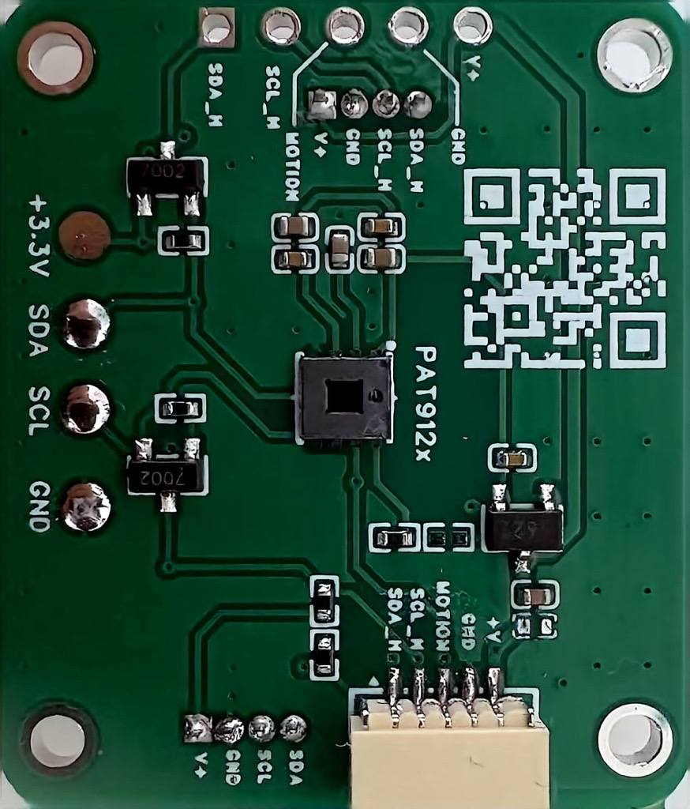
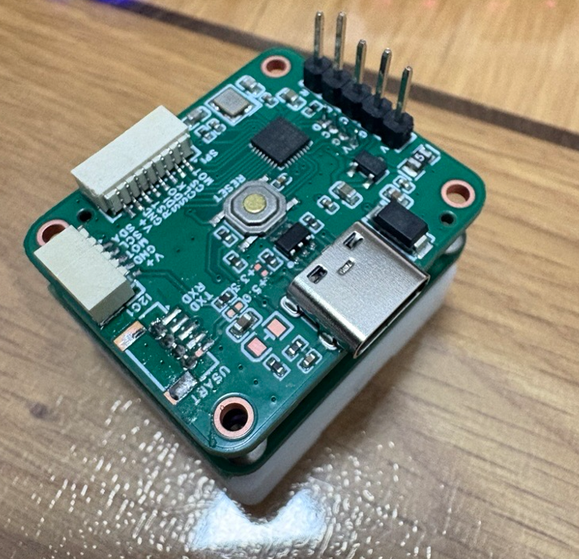
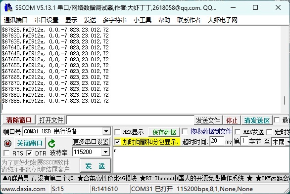

# PAT912x Demo

A demo project based on the AT32F425 MCU and the PAT912x optical flow sensor.

## Repository Structure

- `01-AT32F425-PAT912x/`: Firmware project (CMake)
- `02-Hardware/`: Hardware resources
  - `images/`: Photos and diagrams
  - `schematic/`: Schematics (PDF)

## Hardware

- MCU: Artery AT32F425
- Sensor: PixArt PAT912x optical flow sensor
- Interface: I2C (update to match your design)






## Build

```bash
cd 01-AT32F425-PAT912x
cmake -S . -B build
cmake --build build
